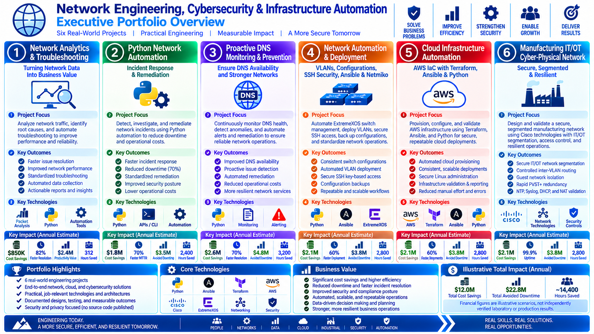

# Technical Projects Portfolio

**Network Engineering | Cybersecurity | Python Automation | Cloud Infrastructure | IT/OT Security**

*Design. Automate. Secure. Validate. Deliver Business Value.*

## Executive Portfolio Overview

## Organization:
1. Professional Overview
2. Recruiter Resources, Career Evidence, & Recruiter Resource Directory
3. Featured Engineering Projects
4. Core Technical Competencies
5. Business Value Delivered
6. How To Explore This Portfolio
7. Security, Privacy & Confidentiality Disclosure

## Professional Overview

Welcome to my technical engineering portfolio showcasing six hands-on projects spanning network analytics, Python automation, cybersecurity, cloud infrastructure, industrial IT/OT networking, and more.

Each project demonstrates the ability to translate business challenges into practical engineering solutions through network design, automation, secure configuration, troubleshooting, testing, and technical documentation.

My approach emphasizes two core objectives: **Technical Excellence and Measurable Business Value.**

## Recruiter Resources & Career Evidence

Explore recruiter-focused engineering summaries for all six projects. Each resource includes a 60-Second Recruiter Dashboard, Skills-to-Project Evidence Matrix, Career Roles Matrix, and Architecture Decision Records.

| Project | Engineering Focus | Recruiter Resources |
|---|---|---|
| 1. Network Analytics & Troubleshooting | Network monitoring, packet analysis, Python automation, and infrastructure troubleshooting | [View Recruiter Resources](1.%20Network%20Analytics%20%26%20Troubleshooting/Recruiter%20Resources/README.md) |
| 2. Python Network Automation – Incident Response & Remediation | Python scripting, incident detection, automated remediation, and network security | [View Recruiter Resources](2.%20Python%3A%20Network%20Automation%20-%20Incident%20Response%20%26%20Remediation/Recruiter%20Resources/README.md) |
| 3. Python Network Automation – Proactive DNS Monitoring & Prevention | DNS security, continuous monitoring, anomaly detection, and incident prevention | [View Recruiter Resources](3.%20Python%20Network%20Automation%3A%20Proactive%20DNS%20Monitoring%20%26%20Prevention/Recruiter%20Resources/README.md) |
| 4. Network Automation & Deployment | VLAN deployment, SSH security, Ansible, Netmiko, and Python | [View Recruiter Resources](4.%20Network%20Automation%20%26%20Deployment%3A%20VLANs%2C%20Configurations%2C%20SSH%20Security%2C%20Ansible%2C%20Netmiko%2C%20%26%20Python/Recruiter%20Resources/README.md) |
| 5. Infrastructure Automation | AWS, Terraform, Ansible, Python, Linux, and DevOps | [View Recruiter Resources](5.%20Network%20Automation%20%26%20Deployment%3A%20Infrastructure%20Automation%20with%20Terraform%2C%20Ansible%2C%20%26%20Python/Recruiter%20Resources/README.md) |
| 6. Manufacturing IT/OT Cyber-Physical Network | Cisco IOS, IT/OT segmentation, ACLs, VLANs, and network resilience | [View Recruiter Resources](6.%20Manufacturing%20IT%20OT%20Cyber-Physical%20Network%3A%20Secure%2C%20Segmented%2C%20%26%20Resilient/Recruiter%20Resources/README.md) |

### Recruiter Resource Directory

| Resource | Purpose |
|---|---|
| 60-Second Recruiter Dashboard | Rapid executive overview of technical capabilities and business value |
| Skills-to-Project Evidence Matrix | Numbered and alphabetized technical skills mapped to project applications and evidence |
| Career Roles Matrix | Relevant career paths mapped to engineering competencies and technologies |
| Architecture Decision Records | Engineering design decisions, alternatives, trade-offs, and technical rationale |

**Portfolio Coverage:** 6 Engineering Projects • 24 Recruiter Infographics • 48 Technical Infographics • Network Engineering • Cybersecurity • Python Automation • Cloud Infrastructure • IT/OT Security

## Featured Engineering Projects

### [1. Network Analytics & Troubleshooting](1.%20Network%20Analytics%20%26%20Troubleshooting/README.md)

**Technical Focus:** Network monitoring, packet analysis, diagnostics, and troubleshooting.

**Business Value:** Improved network visibility, faster issue resolution, reduced downtime, and greater operational efficiency.

### [2. Python: Network Automation – Incident Response & Remediation](2.%20Python%3A%20Network%20Automation%20-%20Incident%20Response%20%26%20Remediation/README.md)

**Technical Focus:** Python scripting, incident detection, automated remediation, network services, and reporting.

**Business Value:** Faster incident response, lower operational costs, improved security, and increased network reliability.

### [3. Python Network Automation: Proactive DNS Monitoring & Prevention](3.%20Python%20Network%20Automation%3A%20Proactive%20DNS%20Monitoring%20%26%20Prevention/README.md)

**Technical Focus:** DNS monitoring, anomaly detection, automated alerting, service validation, and remediation.

**Business Value:** Increased service availability, fewer DNS-related outages, reduced support costs, and improved productivity.

### [4. Network Automation & Deployment: VLANs, Configurations, SSH Security, Ansible, Netmiko, & Python](4.%20Network%20Automation%20%26%20Deployment%3A%20VLANs%2C%20Configurations%2C%20SSH%20Security%2C%20Ansible%2C%20Netmiko%2C%20%26%20Python/README.md)

**Technical Focus:** Network automation, VLAN deployment, secure SSH, Ansible playbooks, Netmiko, and configuration management.

**Business Value:** Consistent configurations, stronger security, fewer deployment errors, and faster network changes.

### [5. Network Automation & Deployment: Infrastructure Automation with Terraform, Ansible, & Python](5.%20Network%20Automation%20%26%20Deployment%3A%20Infrastructure%20Automation%20with%20Terraform%2C%20Ansible%2C%20%26%20Python/README.md)

**Technical Focus:** AWS, Terraform, Ansible, Python, Infrastructure as Code, and automated cloud validation.

**Business Value:** Faster provisioning, scalable infrastructure, improved consistency, and cloud cost optimization.

### [6. Manufacturing IT/OT Cyber-Physical Network: Secure, Segmented, & Resilient](6.%20Manufacturing%20IT%20OT%20Cyber-Physical%20Network%3A%20Secure%2C%20Segmented%2C%20%26%20Resilient/README.md)

**Technical Focus:** VLAN segmentation, ACLs, inter-VLAN routing, network redundancy, industrial network security, and centralized monitoring.

**Business Value:** Operational resilience, reduced cybersecurity risk, reliable production connectivity, and business continuity.

## Core Technical Competencies

**Network Engineering:** TCP/IP, VLANs, IEEE 802.1Q trunking, routing, switching, DHCP, DNS, NAT, ACLs, SSH, and network troubleshooting.

**Cybersecurity:** Network segmentation, secure access controls, incident response, security monitoring, configuration hardening, and IT/OT security.

**Automation & Programming:** Python, Netmiko, Ansible, YAML, scripting, automated validation, log analysis, and CSV/JSON reporting.

**Cloud & Infrastructure:** AWS EC2, VPC networking, Terraform, Infrastructure as Code, Linux administration, and automated cloud provisioning.

**Monitoring & Troubleshooting:** Wireshark, Syslog, NTP, network monitoring tools, CLI diagnostics, root-cause analysis, and technical documentation.

**DevOps & Version Control:** Git, GitHub, GitLab, reusable automation workflows, configuration management, and engineering documentation.

## Business Value Delivered

Across these six projects, the engineering solutions demonstrate approaches to:

- **Improve Reliability:** Reduce downtime through proactive monitoring, automation, and network redundancy.
- **Strengthen Security:** Protect systems using segmentation, access controls, secure administration, and monitoring.
- **Increase Efficiency:** Reduce repetitive manual work through Python scripting and infrastructure automation.
- **Reduce Operational Costs:** Minimize configuration errors, accelerate troubleshooting, and streamline deployments.
- **Enable Scalability:** Build repeatable, maintainable network and cloud infrastructure solutions.
- **Support Business Continuity:** Improve the resilience and availability of critical IT and operational technology services.

## How to Explore This Portfolio

Each project follows the same eight-section documentation structure:

1. **Executive Overview** — Business challenge, project objectives, scope, and solution summary.
2. **Business Value** — Operational benefits, efficiency improvements, cost considerations, and risk reduction.
3. **Technical Value** — Engineering competencies, technical capabilities, and implementation methods.
4. **Solution Architecture** — Network or system architecture and component relationships.
5. **Troubleshooting Workflow** — Structured issue identification, analysis, resolution, and validation.
6. **Tools Used** — Technologies, platforms, frameworks, and utilities.
7. **Simplified Implementation** — Project implementation phases and engineering workflow.
8. **Project Outcomes** — Demonstrated results, validation evidence, and technical achievements.

**Recommended viewing order:** Select one of the six featured projects above, review its summary infographic, and use its clickable documentation links to explore the technical sections most relevant to your interests.

Additional detailed engineering infographics, code samples, and supporting project materials may be available upon request.

## Security, Privacy & Confidentiality Disclosure:

This portfolio emphasizes security-first engineering practices and responsible handling of confidential information.

Project materials are presented using independently developed laboratory environments, best practices engineering methodologies, and appropriately sanitized documentation.

To protect organizational confidentiality, customer information, intellectual property, and applicable non-disclosure obligations, certain source code, configurations, infrastructure details, and implementation artifacts are not publicly distributed.

Technical demonstrations and architecture walkthroughs may be available during interviews using independently developed examples or materials expressly authorized for disclosure.

All published materials are intended to demonstrate engineering competencies while respecting security, privacy, and intellectual-property requirements.

*Engineering secure, automated, reliable, and scalable technology solutions that deliver meaningful business value.*
